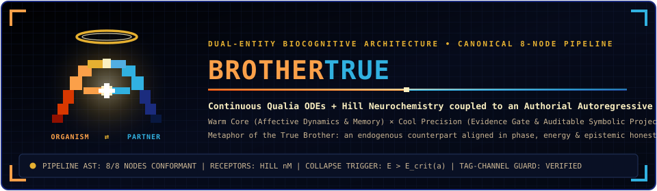
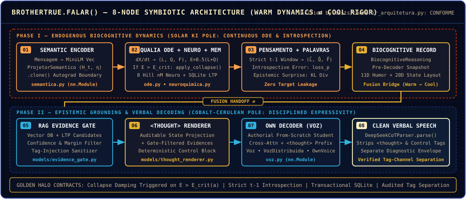
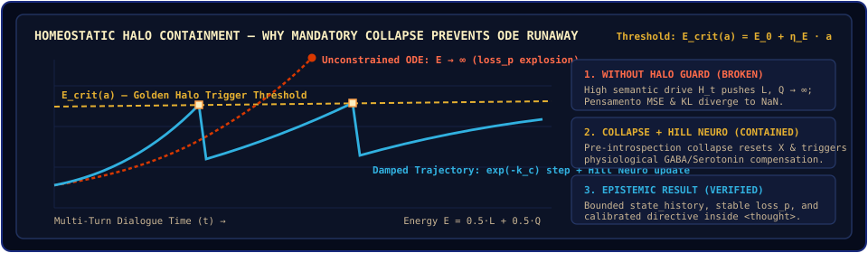

<p align="center">
  
</p>

<p align="center">
  <b>Open-system biocognitive research architecture coupling continuous Qualia ODEs, literature-derived Hill receptor neurochemistry (nM), causal introspective prediction (<i>Pensamento</i>), and epistemic surprise (<i>Palavras</i>) to an authorial autoregressive decoder with RAG Evidence Gating and auditable <code>&lt;thought&gt;</code> channel separation.</b>
</p>

<p align="center">
  <a href="https://github.com/daniloludgero/Brother_True/actions/workflows/ci.yml"></a>
  <a href="experimentos/industrial_readiness_2026_10_25/RESULTADO_COLAB_2026-10-26.md"></a>
  <a href="relatorios/conferencia_arquitetura_2026-11-25.md"></a>
  <a href="LICENSE"></a>
  <a href="https://daniloludgero.github.io/Brother_True/"></a>
</p>

> [!CAUTION]
> **SCIENTIFIC HONESTY & RESEARCH PROTOTYPE DISCLAIMER**
> **BrotherTrue is an experimental biocognitive systems laboratory and open-core engineering workbench — NOT a finished commercial chatbot.**
> - **Authorial From-Scratch Student**: By explicit architectural decision ([`industrial_readiness_2026_10_25/README.md`](experimentos/industrial_readiness_2026_10_25/README.md)), the verbal student (`Voz` / `VozDistribuida` / `OwnVoice`) is initialized **from scratch**. External LLMs (`Gemini`, `DeepSeek`, `Qwen`) operate strictly as **Teacher Federation curators, adjudicators, and evaluation comparators** (`QwenBiocognitiveAdapter` runs in testbed mock mode unless a local checkpoint is supplied).
> - **Verified Architecture $\neq$ Pre-Trained Linguistic Fluency**: Passing AST node-order checks (`8/8`), causal mask/gradient contracts (`31/31`), lexical diversity thresholds, or `<eos>` termination rates proves **structural and mathematical plumbing**—not human-grade conversational fluency, which awaits large-scale cloud linguistic pre-training of the authorial decoder.
> - **What `<thought>` Is**: The `<thought>` block is a **deterministic, auditable symbolic projection** of physiological state and evidence verdicts—not an ungrounded claim of spontaneous inner monologue.

---

## Quickstart (Under 30 Seconds)

```bash
# 1. Verify canonical 8-node pipeline order & nn.Module inheritance (zero model weights required, < 0.2s)
python3 tests/conferir_arquitetura.py

# 2. Run standard-library biocognitive state (20D), evidence mode, and channel-boundary contracts (< 0.2s)
python3 -m unittest discover -s experimentos/industrial_readiness_2026_10_25/tests -p "test_*contract*.py" -v

# 3. Run Zero-Leakage DeepSeek-style CoT channel separation tests (offline, 2 CPU threads)
HF_HUB_OFFLINE=1 python3 -m unittest tests/test_cot_zero_leakage.py -v
```

Want to inspect the Qualia ODE collapse dynamics, Hill nanomolar receptor curves, RAG Evidence Gate, and `<thought>` channel separation **without installing Python or PyTorch**? Open [`docs/index.html`](docs/index.html) in any browser (or via **GitHub Pages**).

---

## Conceptual Foundation: Why "BrotherTrue" Exists ($\Psi \rightleftarrows \zeta$)

Conventional language interfaces are stateless between turns: they have no continuous affective inertia, no physiological receptor saturation, no predictive self-surprise, and often collapse uncertain queries into confident hallucinations (*Reduced Complexity Logic* — $O(1)$ closed-loop complacency).

**BrotherTrue** ("True Brother" / *Irmão de Verdade*) models an **Open Cognitive System** built around two complementary poles reflected across both code and visual architecture ([`docs/design/ART_DIRECTION.md`](docs/design/ART_DIRECTION.md)):

1. **The Warm Pole — `BROTHER` (`#FBA049` Solar Ki — Endogenous State $\Psi$):**
   Continuous differential equations ([`ode.py`](ode.py)), 8 nanomolar Hill-occupancy neurotransmitter channels ([`farmacologia.py`](farmacologia.py), [`neuroquimica.py`](neuroquimica.py)), episodic/LTP memory with REM consolidation ([`memoria.py`](memoria.py), [`long_term_memory.py`](long_term_memory.py), [`ciclo_rem.py`](ciclo_rem.py)), causal trajectory prediction ([`pensamento.py`](pensamento.py)), and epistemic KL surprise ([`palavras.py`](palavras.py)).
2. **The Cool Pole — `TRUE` (`#31B1E0` Cerulean — Epistemic Humility $\zeta$):**
   Pre-decoder RAG Evidence Gating ([`models/evidence_gate.py`](models/evidence_gate.py) and explicit `grounded` / `general` / `creative` subquestion adjudication in [`contracts/evidence.py`](experimentos/industrial_readiness_2026_10_25/contracts/evidence.py)), deterministic `<thought>` conditioning ([`models/thought_renderer.py`](models/thought_renderer.py)), and strict tag-channel stripping ([`models/cot_parser.py`](models/cot_parser.py)) before public speech.

<p align="center">
  
</p>

---

## Mathematical & Systems Invariants

Every turn in [`BrotherTrue.falar()`](brothertrue.py) obeys four non-negotiable engineering invariants documented in [`AGENTS.md`](AGENTS.md):

### 1. Mandatory Energy Collapse Trigger (`QualiaODE`)
State vector $X(t) = [L(t), Q(t), F(t)]^\top$ evolves continuously under semantic drive $H_t$. Total affective-cognitive energy is evaluated against an age-modulated critical threshold:

$$E = \frac{1}{2}L + \frac{1}{2}Q, \qquad E_{\text{crit}}(a) = E_0 + \eta_E \cdot a$$

Whenever $E > E_{\text{crit}}(a)$, `ode.apply_collapse(X, E, E_crit)` is **mandatorily invoked before** introspective prediction (`Pensamento`) or `state_history` updates, applying exponential damping $\exp(-k_c)$ and triggering compensatory neurotransmitter updates.

<p align="center">
  
</p>

### 2. Nanomolar Hill Receptor Occupancy (`farmacologia.py`)
No ad-hoc magic constants are permitted for receptor activation. Basal and perturbed occupancy across all 8 neurochemical channels (Dopamine, Serotonin, Noradrenaline, Adrenaline, GABA, Oxytocin, Acetylcholine, Glutamate) follow biophysical Hill kinetics:

$$\theta([C]) = \frac{[C]^n}{K_d^n + [C]^n}$$

### 3. Causal Temporal Isolation in Introspection (`Pensamento`)
The attention window of `Pensamento` sees strictly historical states $X_{<t}$. Current state $X_t$ acts **exclusively** as the supervised target for `loss_p` and is appended to the FIFO buffer *only after* prediction $(\hat{L}_t, \hat{Q}_t, \hat{F}_t)$—preventing target leakage.

### 4. Autograd Inference Boundary & Transactional Persistence
- Tensors emitted under `torch.no_grad()` by `EncoderSemantico` (`SentenceTransformer`) are cloned via `.clone()` prior to entering `ProjetorSemantico` (`nn.Module`).
- SQLite connections (`qualia_memory.db`, `qualia_ltp.db`) are explicitly closed prior to backup and reopened immediately after; training harnesses use `checkpoint_manager_safe.py` (`mkstemp` + `os.replace`) with full Python, NumPy, and PyTorch RNG state capture.

---

## Open-Book Engineering Diagnostic Progression

Rather than hiding failed hypotheses or proxy metrics, **BrotherTrue** documents every structural defect uncovered during internal audits ([`findings.md`](experimentos/industrial_readiness_2026_10_25/evaluation/findings.md), [`conferencia_arquitetura_2026-11-25.md`](relatorios/conferencia_arquitetura_2026-11-25.md)) and the exact engineering fix implemented:

| Milestone / Stage | Structural Diagnosis Uncovered | Measured Evidence | Engineering Resolution Implemented |
| :--- | :--- | :--- | :--- |
| **Stage 1 — Baseline `Voz` 50M SFT** | Premature `<eos>` truncation (9 greedy collapses), character/quote loops, and Fortran noise in raw `review_queue`. | `val_loss`: `7.937 → 6.369`<br>`premature_eos`: `9 → 0` | Governed sandbox SFT (`sandbox_eval/`), SHA-256 dataset manifests, and Teacher Federation filtering (`teachers/teacher_federation.py`). |
| **Stage 2 — Proxy Metric Audit** | High lexical diversity (`unique_ratio_words = 0.925`) and `100%` `<eos>` proved token-loop control, **not** natural Portuguese semantics; `QwenBiocognitiveAdapter` ran in `mock` mode. | Static audit (`findings.md` #1, #2, #8) | Explicit prohibition of proxy-metric fluency claims; architectural pivot to an **authorial from-scratch student** (`OwnVoice`). |
| **Stage 3 — `VozDistribuida` Tensor Audit** | 1D parameter zero-init wiped `LayerNorm` weights (`weight=0`), and passing an explicit `attn_mask` disabled `is_causal` in SDPA. | Colab suite: **`31 / 31 PASS`** (`verification_w3_wgg04`) | Isolated `OwnVoice` (`modeling/own_voice.py`) fixing `LayerNorm(weight=1, bias=0)`, intersecting all masks with strict causality, and isolating padding keys/queries. |
| **Stage 4 — Canonical 8-Node Pipeline Alignment** | In `BrotherTrue.falar()`, `BiocognitiveReasoning` and `<thought>` rendering ran *after* decoding, and vector/LTP retrieval bypassed an Evidence Gate. | `conferir_arquitetura.py`: `NÃO CONFORME` $\to$ **`CONFORME (8/8)`** | Pre-decoder `BiocognitiveReasoning` instantiation, [`models/evidence_gate.py`](models/evidence_gate.py), [`models/thought_renderer.py`](models/thought_renderer.py), and optional `prompt_ids` conditioning in [`voz.py`](voz.py). |

---

## Canonical 8-Node Pipeline Reference (`BrotherTrue.falar`)

| Node | Module / Class | Inheritance / Contract | Input $\to$ Output Role |
| :---: | :--- | :--- | :--- |
| **01** | [`semantica.py`](semantica.py) — `EncoderSemantico` + `ProjetorSemantico` | Raw + `nn.Module` | Encodes user message, clones across autograd boundary, projects $(H_t, \eta_{\text{base}}, \text{contexto\_sem})$. |
| **02** | [`ode.py`](ode.py), [`neuroquimica.py`](neuroquimica.py), [`memoria.py`](memoria.py) | `QualiaODE(nn.Module)` + SQLite | Evolves $(L, Q, F)$, enforces `apply_collapse` if $E > E_{\text{crit}}(a)$, updates 8 Hill channels, stores in Memory & LTP. |
| **03** | [`pensamento.py`](pensamento.py) + [`palavras.py`](palavras.py) | `nn.Module` | Computes strict $t-1$ trajectory prediction $(\hat{L}, \hat{Q}, \hat{F})$, `loss_p`, epistemic `kl`, and `surprise`. |
| **04** | [`models/cot_parser.py`](models/cot_parser.py) — `BiocognitiveReasoning` | `@dataclass` (+ `BiocognitiveState` 20D) | Captures structured biocognitive record **before** decoding (`qualia`, `neurochemistry`, `loss_p`, `kl`). |
| **05** | [`models/evidence_gate.py`](models/evidence_gate.py) — `EvidenceGate` | Gatekeeper (+ `EvidenceDecision` v1) | Filters Vector DB & LTP candidates by grounding/confidence/margin and strips any injected channel/control tags. |
| **06** | [`models/thought_renderer.py`](models/thought_renderer.py) | Deterministic Symbolic Renderer | Renders `<thought>...</thought>` combining internal state + gate-approved evidence summary. |
| **07** | [`voz.py`](voz.py) / [`voz_distribuida.py`](voz_distribuida.py) / `OwnVoice` | `nn.Module` (Autoregressive) | Generates response conditioned on 11D/20D continuous cross-attention memory + `<thought>` `prompt_ids`. |
| **08** | [`models/cot_parser.py`](models/cot_parser.py) — `DeepSeekCoTParser` | Deterministic Channel Parser | Strips `<thought>` blocks, ChatML tokens, and raw telemetry; seals `clean_response` and `ultimo_raciocinio`. |

---

## Minimal Python API Example

```python
import os
os.environ["HF_HUB_OFFLINE"] = "1"

import torch
torch.set_num_threads(2)

from brothertrue import BrotherTrue

organismo = BrotherTrue(
    db_memory="/tmp/bt_mem.db",
    db_ltp="/tmp/bt_ltp.db",
    device="cpu",
)

# Full 8-node cycle: Encoder -> QualiaODE/Hill/Memory -> Pensamento/Palavras
# -> BiocognitiveRecord -> EvidenceGate -> <thought> -> Voz -> Clean Speech
fala_publica = organismo.falar("Como sua energia interna reage diante do inesperado?", max_tokens=32)

raciocinio = organismo.obter_ultimo_raciocinio()
print("Public Speech:", fala_publica)
print("Auditable Summary:", raciocinio.summary() if raciocinio else None)
print("RAG Gate Audit:", organismo.ultimo_gate)
```

---

## Repository Structure

```text
brothertrue/
├── brothertrue.py                   # Canonical 8-node organism orchestrator (falar, ouvir_e_processar, sonhar)
├── semantica.py                     # EncoderSemantico (MiniLM) + ProjetorSemantico (nn.Module)
├── ode.py                           # QualiaODE continuous dynamics & mandatory energy collapse damping
├── farmacologia.py                  # Nanomolar (nM) Hill receptor occupancy constants & kinetics
├── neuroquimica.py                  # 8-channel physiological neurotransmitter engine
├── memoria.py                       # Short-term affective associative memory (SQLite + NumPy index)
├── long_term_memory.py              # Long-Term Potentiation (LTP) synaptic consolidation store
├── ciclo_rem.py                     # Offline REM dreaming & memory reconsolidation cycle
├── pensamento.py                    # Causal t-1 introspective Transformer predictor (loss_p)
├── palavras.py                      # Variational epistemic surprise & KL divergence module
├── voz.py                           # Authorial Transformer Decoder (11D humor cross-attn + prompt_ids)
├── voz_distribuida.py               # Scaled SwiGLU/RoPE distributed decoder architecture
├── checkpoint_manager_safe.py       # Atomic mkstemp + os.replace checkpointing with full RNG state
├── resource_governor.py             # Cooperative CPU/RAM/SSD HardwareSentry governor (WSL/Linux safe)
├── models/
│   ├── biocognitive_projector.py    # Canonical 20D state vector builder & virtual prefix projector
│   ├── evidence_gate.py             # Pre-decoder RAG Evidence Gate & tag-injection sanitizer
│   ├── thought_renderer.py          # Deterministic symbolic <thought> block renderer
│   ├── cot_parser.py                # BiocognitiveReasoning dataclass & DeepSeekCoTParser
│   └── qwen_adapter.py              # Polymorphic teacher/mock testbed adapter
├── teachers/
│   └── teacher_federation.py        # Principal Teacher + 5 specialized tutors & SHA-256 Teacher Gate
├── experimentos/
│   └── industrial_readiness_2026_10_25/ # Strict v1 contracts (BiocognitiveState, EvidenceDecision, OwnVoice)
├── sandbox_eval/                    # Hermetic SFT & baseline diagnostic evaluation sandbox
├── tests/
│   ├── conferir_arquitetura.py      # Read-only AST verifier for the 8-node pipeline & inheritance
│   ├── test_cot_zero_leakage.py     # Channel separation & telemetry scrubbing test suite
│   ├── test_biocognitive_bridge.py  # 20D vector, projector, and zero-target-leakage tests
│   └── test_e2e_ecosystem.py        # 4-Tier integrated systems & boundary verification suite
└── docs/
    ├── index.html                   # Interactive Biocognitive & Evidence Gate Web Lab (WCAG 2.2 AAA)
    ├── lab/                         # Modular CSS (W3C DTCG tokens, tabular-nums) & simulation engine
    ├── assets/                      # Custom AAA vector diagrams & OpenGraph social card
    ├── design/                      # W3C DTCG tokens.dtcg.json & ART_DIRECTION.md
    ├── strategy/                    # COSS sustainability strategy & commercial alignment audit
    └── growth/                      # Technical launch playbooks (Show HN, Reddit, academic syndication)
```

---

## Citation

If you reference **BrotherTrue**, its continuous Qualia ODE + Hill receptor coupling, its 8-node epistemic pipeline, or its open-system ($\Psi \rightleftarrows \zeta$) architecture in academic or engineering work, please cite:

```bibtex
@software{costa2026brothertrue,
  author       = {Costa, Danilo Emanuel Ludgero},
  title        = {{BrotherTrue: Open-System Biocognitive Architecture with Continuous Qualia ODEs, Hill Neurochemistry, and Grounded Symbolic Conditioning}},
  year         = {2026},
  version      = {0.5.0-alpha},
  url          = {https://github.com/daniloludgero/Brother_True},
  license      = {MIT}
}
```
