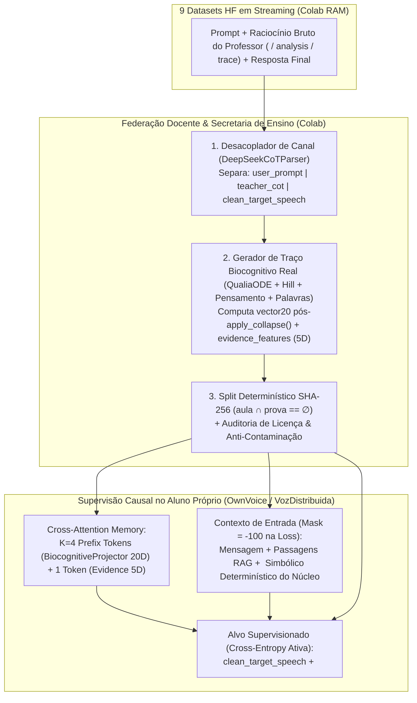

# Guia Canônico do Modelo Professor: Destilação, Roteamento de Agentes e Distribuição Arquitetural do Aluno `BrotherTrue`

**Autoria & Direção Pedagógica:** Modelo Professor Principal (Gemini PhD Lead — Arquiteto Curricular & Árbitro Epistêmico)  
**Aluno Alvo:** Decoder Autoral `BrotherTrue` (`Voz` / `VozDistribuida` / `OwnVoice`, inicializado do zero)  
**Regra de Infraestrutura:** **100% Cloud-Only (Google Colab Runtime $\to$ Google Drive)**. Zero bytes de datasets brutos ou destilados gravados no SSD local `C:`.

---

## 1. Como a Arquitetura Atual Funciona Durante a Destilação (Visão Sistêmica)

Um erro fatal em pipelines convencionais de destilação é despejar pares `(prompt, <think>...resposta)` de LLMs gigantes diretamente na função de perda (*cross-entropy*) de um aluno compacto. No **BrotherTrue**, se fizermos isso sem separar os canais, destruímos os dois pilares do organismo:
1. O aluno passaria a **alucinar números fisiológicos falsos** em texto livre em vez de obedecer ao seu verdadeiro núcleo contínuo (`QualiaODE` + receptores de Hill em nanomolar); e
2. A fala pública vazaria raciocínios intermediários brutos de professores externos.

Por isso, a arquitetura homologada de **8 nós (`BrotherTrue.falar`) + `OwnVoice` (`industrial_readiness_2026_10_25`)** separa estritamente **três fluxos de informação** durante o treinamento:



### Regra de Ouro da Supervisão Causal no Aluno (`Mask = -100`)
Ao treinar o decoder próprio (`OwnVoice` / `Voz`):
- **O que entra mascarado com `ignore_index = -100` (Contexto Condicionante, NÃO previsto pelo aluno):**
  1. A mensagem do usuário (`user_prompt`);
  2. Os trechos documentais recuperados (em campo de dados isolado);
  3. O bloco `<thought>...</thought>` renderizado **deterministicamente pelo `ThoughtRenderer`** a partir do vetor real de 20 dimensões do núcleo (`L, Q, F`, 8 ocupações de Hill em $nM$, predições $\hat{L},\hat{Q},\hat{F}$, $\Delta X$, `loss_p`, `KL`, `surprise` e veredicto do `EvidenceGate`).
- **Para onde vai o `<think>` / `analysis` original dos datasets professores (DeepSeek, Qwen, Atlas, Multilingual-Thinking)?**
  - Ele **NÃO substitui** o `<thought>` fisiológico do BrotherTrue! Ele é preservado em uma coluna separada (`teacher_reasoning_trace`) no Drive para **três usos docentes exclusivos**:
    1. **Calibração de Complexidade e Surpresa Epistêmica:** Medir a densidade lógica/passos do professor para rotular a dificuldade curricular e auditar se `loss_p` / `KL` reagem proporcionalmente;
    2. **Destilação Auxiliar de Subquestões / Decomposição (Estágio SFT Raciocínio Explícito, quando solicitado em modo `general`)**: Apenas quando reformatado como explicação passo-a-passo limpa fora de tags internas;
    3. **Juiz Semântico (LLM-as-a-Judge / CAI / DPO):** Verificar que a `clean_target_speech` realmente decorre de uma cadeia lógica válida antes de aprovar o exemplo para o aluno.

---

## 2. Diretrizes Obrigatórias para Futuros Agentes Professores

Qualquer agente professor ou subagente futuro (Gemini Pro/Flash, DeepSeek, Qwen, Kimi, GLM, Pedagogo CAI ou Amigo Provocativo DPO) que gere, filtre ou avalie dados para o BrotherTrue **DEVE** obedecer aos **7 Mandamentos da Federação Docente**:

1. **Proibição de Valores Fisiológicos Inventados (`Zero Synthetic Physiology`)**:
   - Nenhum agente professor pode inventar valores literais de $L, Q, F$ ou nanomolar no texto da resposta. Todo vetor `vector20` no dataset deve ser gerado executando `QualiaODE.evolve()` $\to$ `apply_collapse()` (se $E > E_{\text{crit}}(a)$) $\to$ `NeuroTransmissor` (Hill $nM$) $\to$ `Pensamento` ($t-1$) $\to$ `Palavras` (`KL`), gravando o hash de proveniência do núcleo.
2. **Isolamento de Modos Epistêmicos (`grounded` vs. `general` vs. `creative`)**:
   - **Modo `grounded` (Documental/RAG):** O professor deve ensinar o aluno a responder **somente** o que está sustentado nas passagens aprovadas pelo `EvidenceGate`, ou **abster-se explicitamente** quando a evidência for insuficiente ou conflitante ($\zeta \neq 0$). Jamais recompensar "chutes confiantes".
   - **Modo `general` (Matemática, Código, Ciências, Diálogo):** Permite raciocínio dedutivo e conhecimento aprendido, distinguindo fatos de inferências.
   - **Modo `creative` (Metáfora, Ficção, Provocação Amigável):** Permite hipóteses e imaginação, desde que declaradas sem falsa atribuição documental.
3. **Separação Determinística de `aula` e `prova` (`SHA-256 Split`)**:
   - Nenhum professor pode escolher manualmente quais exemplos vão para validação. O hash `SHA-256(normalized_prompt)` destina deterministicamente `90%` para `aula` (treino) e `10%` para `prova` (avaliação retida: `aula ∩ prova == ∅`).
4. **Orçamento de Tokens Compatível com a Janela Real do Aluno**:
   - O professor não deve despejar paredes enciclopédicas prolixas de 8.000 tokens em um decoder compacto em fase de alfabetização estrutural. As respostas aprovadas são classificadas em **3 faixas curriculares**:
     - *Faixa Curta (`<= 128` tokens):* Conversação natural, acústica/fala transcrita, respostas diretas.
     - *Faixa Média (`129–512` tokens):* Explicações conceituais, código enxuto, empatia e grounding RAG.
     - *Faixa Longa (`513–2048` tokens):* Provas matemáticas formais (`AoPS`, `DeepSeek-Math`), traces agênticos multi-etapa (`TeichAI`) para a arquitetura escalada (`OwnVoice` com RoPE).
5. **Política de Licenças & Uso em Produção vs. Referência Docente**:
   - Cada registro destilado carrega `source_license`. Datasets `MIT` / `Apache-2.0` / `CC-BY-4.0` formam o **Tronco Comercial Limpo (`core_permissive`)**; datasets com `CC-BY-SA-4.0` ou `other/unknown` ficam isolados em partições rotuladas (`research_or_audit_only`) para nunca contaminar pesos comerciais fechados sem revisão jurídica.
6. **Âncora de Prior KL & `enabled_by_default: false`**:
   - Nenhum lote novo de um professor promove um checkpoint automaticamente. Exige-se medir ganho real em `prova` sem explodir a divergência em relação ao prior homeostático nem regredir nos casos anti-alucinação.
7. **Zero Escrita Local (`Cloud-Strict Offloading`)**:
   - Toda leitura ocorre com `load_dataset(..., streaming=True)` na RAM da instância Google Colab, gravando shards compactados (`.jsonl.gz` / `.parquet`) + `manifest_sha256.json` diretamente em `/content/drive/MyDrive/BrotherTrue_Distillation_Hub/`.

---

## 3. Mapeamento Arquitetural dos 9 Datasets Solicitados

Cada um dos 9 datasets cumpre um papel cirúrgico nos subsistemas do BrotherTrue e é roteado para um **Tutor Especialista** específico da Federação:

| # | Dataset HuggingFace (`config`) | Papel na Arquitetura do BrotherTrue | Tutor Responsável | Extração de Colunas $\to$ Esquema Canônico | Partição de Licença |
| :-: | :--- | :--- | :--- | :--- | :--- |
| **1** | `Jackrong/DeepSeek-V4-Pro-Distilled-200K` (`"Math"`) | Dedução formal rigorosa; calibra cautela analítica sob alta energia lógica $L$ | **Tutor 2 (STEM & Provas)** | `input` $\to$ `prompt`; `output` desacoplado via `<think>` em `teacher_cot` + `clean_response` | `cc-by-4.0 / cc-by-sa-4.0` (partição auditada) |
| **2** | `Trelis/openassistant-deepseek-coder` | Síntese algorítmica e engenharia de código concisa e estruturada | **Tutor 2 (Código & Sistemas)** | Parse de `### Instruction:` / `### Response:` em `text` $\to$ `prompt` + `clean_response` | `apache-2.0` (`core_permissive`) |
| **3** | `TeichAI/DeepSeek-v4-Pro-Agent` | Planejamento multi-passo, decomposição de ferramentas e contenção de erro em execução | **Tutor 4 (Agêntico & Grounding)** | `prompt` + `messages` JSON (isolando chamadas `tools` do resumo verbal final) | `unspecified` (`research_or_audit_only`) |
| **4** | `DeepStudentLlama/AoPS-Instruct` (`"default"`) | Resolução olímpica criativa (Art of Problem Solving); treina persistência estruturada sem atalhos $O(1)$ | **Tutor 2 (STEM Avançado)** | `messages` (`user` $\to$ `prompt`, `assistant` $\to$ `teacher_cot` + `clean_response`) | `mit` (`core_permissive`) |
| **5** | `HuggingFaceH4/Multilingual-Thinking` | Transferência multilíngue e separação nativa entre raciocínio interno (`analysis`) e fala (`final`) | **Tutor 1 & 5 (Multilíngue & Empatia)** | `user` $\to$ `prompt`; `analysis` $\to$ `teacher_cot`; `final` $\to$ `clean_response` (+ `reasoning_language`) | `apache-2.0` (`core_permissive`) |
| **6** | `Manusagents/GPT-5.5-Gemini-3.1-Pro-...-Distillation-Dataset` | Conhecimento enciclopédico amplo multi-professor (evita hiper-especialização estreita) | **Professor Principal (Consenso)** | Parse de `instruction` (`messages` ou texto) + `response` $\to$ `clean_response` (`category`) | `mit` (`core_permissive`) |
| **7** | `r0b0tlab/qwen3.8-max-glm5.2-kimi-k3-distillation` (`"sft_balanced"`) | Ouro de governança: já traz `verifier_passed`, `reference_agreement` e `format_score_raw` | **Árbitro Gatekeeper** | Filtra `verifier_passed == True`; extrai `messages_json` separando `<think>` de `clean_response` | `source_license` por linha (roteamento dinâmico) |
| **8** | `prithivMLmods/Atlas-Think-Cot-12M` | Escala massiva de raciocínio passo-a-passo (`12M`) para pré-treino/SFT de cadeia longa | **Tutor 2 & 3 (CoT Estruturado)** | `problem` $\to$ `prompt`; `solution` separado via `<think>` em `teacher_cot` + `clean_response` | `apache-2.0` (`core_permissive`) |
| **9** | `facebook/multilingual_librispeech` (`"french"`) | Prosódia de fala humana real transcrita, cadência oral natural (curta duração) e ancoragem fonética/multilíngue **sem baixar áudio pesado para o corpus textual** | **Tutor 1 (Cadência Oral & Voz)** | **Importante:** remove coluna binária `audio` via `.select_columns(...)` no stream Parquet para não saturar rede/Drive; extrai `transcript`, `audio_duration`, `speaker_id` para naturalidade oral francesa | `cc-by-4.0` (`core_permissive`) |

---

## 4. Esquema Canônico Unificado de Saída no Google Drive (`DistilledBrotherTrueRecord v1`)

Todos os 9 datasets são normalizados em tempo real no Colab para um único contrato JSONL comprimido (`.jsonl.gz`) salvo em `/content/drive/MyDrive/BrotherTrue_Distillation_Hub/v1_2026_11_26/`:

```json
{
  "record_id": "sha256_prefix_24",
  "dataset_source": "HuggingFaceH4/Multilingual-Thinking",
  "dataset_config": "default",
  "tutor_assigned": "tutor_1_5_multilingual",
  "epistemic_mode": "general",
  "license_tier": "core_permissive",
  "source_license": "apache-2.0",
  "curriculum_band": "medium_129_512",
  "split": "aula",
  "prompt": "Texto limpo de entrada do usuário...",
  "teacher_reasoning_trace": "Raciocínio extraído de <think>/analysis (NUNCA injetado cru na fala pública)...",
  "clean_target_speech": "Resposta verbal 100% limpa de tags <think>/<thought> e tokens de controle...",
  "biocognitive_trace": {
    "source": "qualia_ode_rk4_deterministic_v1",
    "collapse_checked": true,
    "collapsed": false,
    "energy": 1.3842,
    "energy_crit": 2.9600,
    "vector20": [1.41, 1.35, 0.18, "... (20 floats finitos validados)"]
  },
  "sha256": "hash_completo_do_registro"
}
```

---

## 5. Curriculum de Treinamento Recomendado para o Decoder Próprio (`OwnVoice`)

Quando os shards destilados no Drive alimentarem o `own_decoder_runner.py` em GPU (L4/A100 no Colab Pro), os futuros agentes treinadores devem seguir rigorosamente **3 Estágios Progressivos**:

1. **Estágio A — Alfabetização Fluente e Cadência Oral (`curriculum_band = short` + `medium`, sem exigir provas longas):**
   - Mistura: `Multilingual-Thinking` (`final`), `Multilingual LibriSpeech` (ritmo de fala natural), `Manusagents` (conhecimento geral claro) e `r0b0tlab sft_balanced`.
   - Objetivo: Estabilizar gramática, coesão semântica e parada natural `<eos>` com condicionamento contínuo `BiocognitiveProjector` ($K=4$ tokens).
2. **Estágio B — Dedução Estruturada, Código e Planejamento (`medium` + `long`):**
   - Mistura: `Trelis DeepSeek Coder`, `Jackrong DeepSeek Math`, `AoPS-Instruct`, `Atlas-Think-Cot-12M` e `TeichAI Agent`.
   - Objetivo: Ensinar resolução profunda sob alta ativação de `L` (Lucidez/Foco Dopaminérgico) mantendo `<thought>` interno estritamente separado da resposta pública.
3. **Estágio C — Calibração Epistêmica (`grounded` vs. abstenção) & Alinhamento DPO/CAI:**
   - Injeção de casos positivos, parciais, ausentes e contraditórios do `EvidenceGate`, garantindo que surpresa `KL` alta ou `loss_p` alto aumentem a cautela verbal sem jamais falsificar citações documentais.
